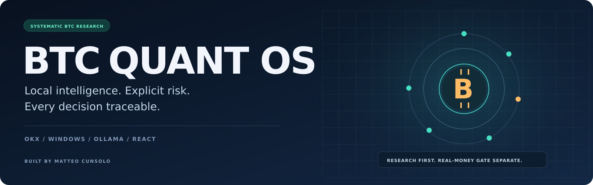
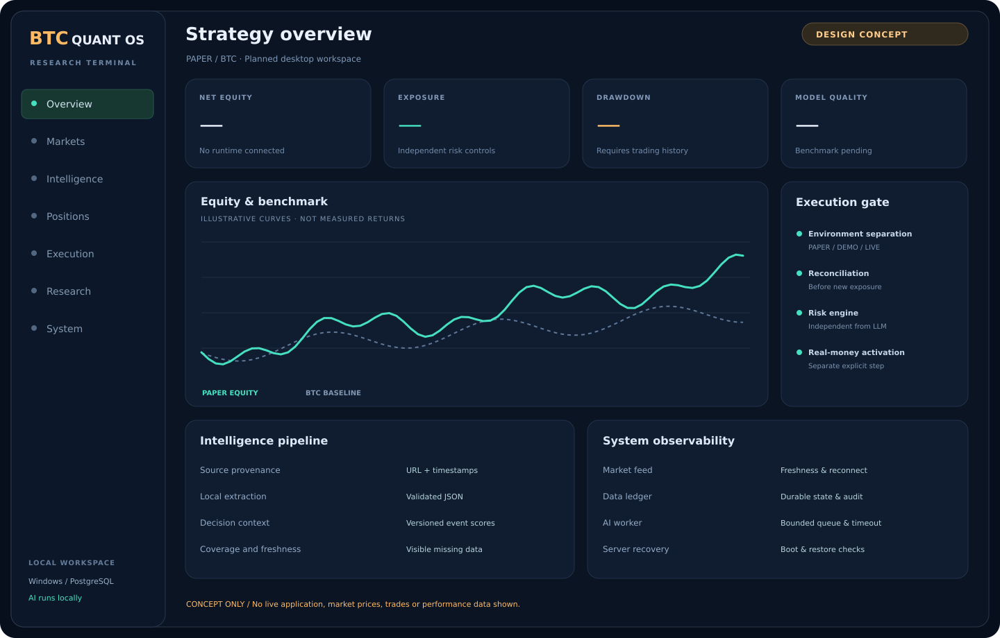
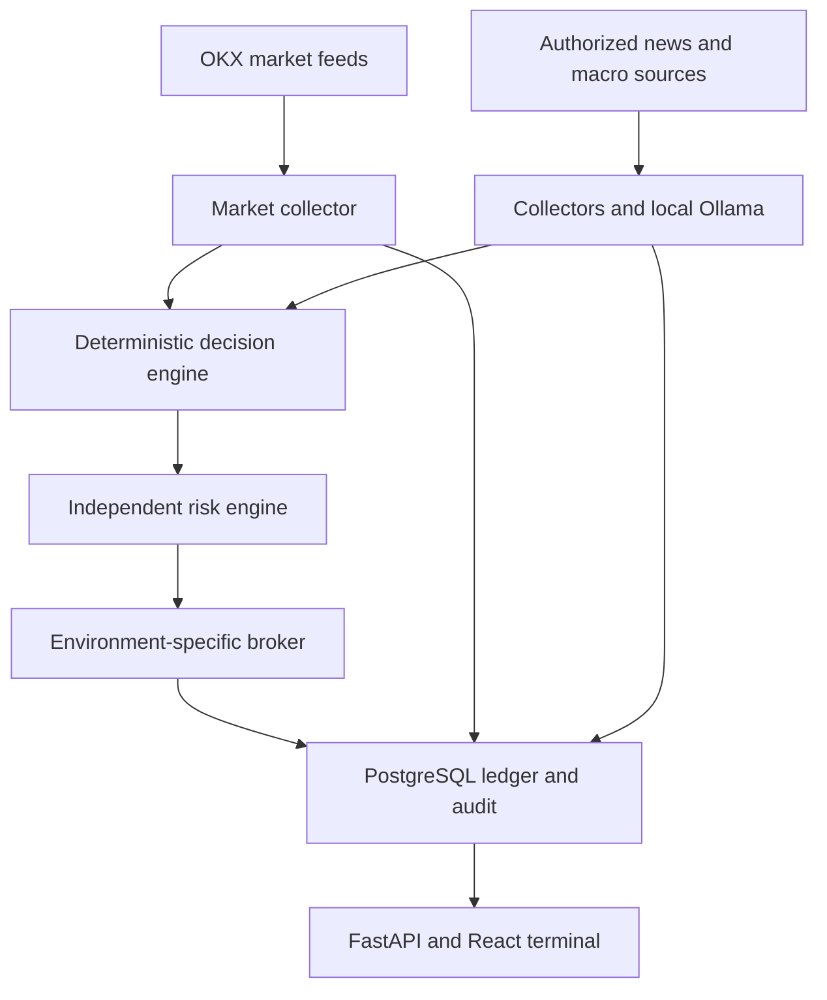

  

  <a href="docs/START_HERE.md"><strong>Start here</strong></a> ·
  <a href="docs/STATUS.md"><strong>Project status</strong></a> ·
  <a href="docs/ARCHITECTURE.md"><strong>Architecture</strong></a> ·
  <a href="docs/prompts/01_R1_PAPER.md"><strong>Build with Astra</strong></a>

  
  
  
  

# A complete operating environment for BTC research and execution

**BTC Quant OS** is a local-first platform connecting Bitcoin market data, systematic decisions, independent risk controls and quantitative analytics in one desktop trading terminal.

The target: a Windows server that collects data around the clock, trades in a realistic internal paper environment, explains each decision and remains observable through a React dashboard. Local AI structures news and events; deterministic code owns orders, accounting and risk.

> **Current state — R1 internal PAPER.** The backend, PostgreSQL ledger, React UI, independent risk engine and guided Windows setup are implemented. Download the verified PAPER release and launch `START_PAPER.bat`. The owner’s Windows server still requires local acceptance. The illustration below remains a design concept. [Actual status and limits →](docs/STATUS.md)

## The terminal we are building

  

DESIGN CONCEPT · Illustrative layout and curves · Not an application screenshot · No measured performance

## One platform. Three separate responsibilities.

| Market & execution | Intelligence & research | Operations & visibility |
| :--- | :--- | :--- |
| OKX regional REST/WebSocket adapters | Macro, cross-asset and crypto context | React + TypeScript terminal |
| Internal paper broker on live prices | News and authorized social collectors | Orders, positions and decision audit |
| Long / short / flat target exposure | Local Ollama structured extraction | Equity, drawdown and cost analytics |
| Idempotent orders and reconciliation | Provenance, freshness and deduplication | Process, feed and backup health |
| Independent exposure and loss limits | Versioned scores and model evaluation | Windows startup and crash recovery |

*The table combines the implemented R1 core with planned R2/R3 scope. Availability is tracked in [STATUS](docs/STATUS.md), not implied by this overview.*

## The architecture

The LLM cannot issue orders, execute shell commands or access trading secrets. A slow intelligence queue must not delay protective position management. PAPER, DEMO and LIVE use separate execution and accounting contexts.

## From first simulation to evaluated live capability

| Milestone | What it delivers | Current state |
| :--- | :--- | :--- |
| **Foundation** | Repository identity, documentation, handoff and autonomous development instructions | Available |
| **R1 · Paper core** | Live public feed, internal broker, ledger, risk controls, first UI and guided Windows setup | Implemented; server acceptance pending |
| **R2 · Intelligence** | Local AI, collectors, event scoring, research views and complete analytics UI | Planned |
| **R3 · Operations** | Recovery, reconciliation, verified regional adapter and explicit live-readiness gates | Planned |

Development agents are authorized to implement, verify and merge their own requested changes. Passing applicable checks is required; a merge does not automatically deploy software to the server or activate real-money trading.

## Start PAPER — one launcher

Download **BTC-Quant-OS-v0.1.0-paper.zip** from the [PAPER release](https://github.com/MatCuns/BTC-Trading-OS/releases/tag/v0.1.0-paper), extract it on Windows, then double-click **START_PAPER.bat**.

The wizard checks Python 3.12 and PostgreSQL, points to official installers where required, asks for local folders and configures the database without exposing credentials. The release ZIP includes the compiled terminal; no Node server or OKX key is needed. Start with the kill switch engaged and strategy OFF. LIVE remains disabled.

[Guida per Matteo →](docs/START_HERE.md) · [Server operations →](docs/OPERATIONS.md) · [Acceptance gates →](docs/ACCEPTANCE.md)

For development, read [AGENTS](AGENTS.md) and [STATUS](docs/STATUS.md). R2 intelligence is the next development phase after R1 server acceptance. The R1 prompt is retained as the implementation specification, not an instruction to rebuild the project.

## Built around the hardware already available

| Component | Initial design target |
| :--- | :--- |
| Host | Windows x64 · Intel Xeon E3-1220 v3 · 16 GB DDR3 |
| Local model | Ollama `qwen3:1.7b` · one request at a time · short validated JSON |
| GPU | GTX 1050 Ti 4 GB · actual offload and latency to be measured |
| Storage | Existing 128 GB system SSD + mirrored HDD data volume |
| Stack | Python 3.12 · FastAPI · PostgreSQL · React · TypeScript |
| Access | Localhost dashboard through Chrome Remote Desktop |

No mandatory Docker, WSL, new GPU or paid social feed. The chosen model is a starting configuration to benchmark, not a promise of accuracy or latency.

## Engineering principles

- **Evidence before confidence.** Missing or stale data is visible. Probabilities are not presented as calibrated without out-of-sample evidence.
- **Costs belong in the ledger.** Fees, spread, simulated slippage and funding are accounted for explicitly.
- **Regional compatibility is a requirement.** The actual OKX account and instrument must be verified against official documentation. No silent substitution with a global perpetual contract.
- **Durable state before new exposure.** Unknown order state, failed persistence or critical stale feeds block new entries.
- **Autonomous development, explicit live activation.** Agents own code delivery. Capital deployment remains separate.

## Find the right document

| Question | Document |
| :--- | :--- |
| What do I do now? | [START_HERE](docs/START_HERE.md) |
| What is actually implemented? | [STATUS](docs/STATUS.md) |
| What should an agent read first? | [AGENTS](AGENTS.md) |
| How do the components connect? | [ARCHITECTURE](docs/ARCHITECTURE.md) |
| How do we add, change or remove features? | [DEVELOPMENT](docs/DEVELOPMENT.md) |
| How is the Windows server operated? | [OPERATIONS](docs/OPERATIONS.md) |
| Which full prompt comes next? | [R1](docs/prompts/01_R1_PAPER.md) · [R2](docs/prompts/02_R2_INTELLIGENCE.md) · [R3](docs/prompts/03_R3_OPERATIONS.md) |
| What changed? | [CHANGELOG](docs/CHANGELOG.md) |

<strong>Execution environments and real-money scope</strong>

**INTERNAL_PAPER** simulates execution against live market input, with explicit assumptions. **OKX_DEMO** tests supported exchange API behavior using demo credentials. **OKX_LIVE** is planned and remains disabled until account eligibility, instrument specifications, operations and forward evidence have been evaluated.

The technical exposure ceiling is 5×, with a lower initial default. This is an application limit, not a guarantee of product availability or a recommendation to use leverage. X-Perps have expiry and product-specific mechanics. Stop orders do not guarantee a maximum loss. No return, profitability or OKX certification is claimed.

---

<strong>LOCAL INTELLIGENCE · EXPLICIT RISK · TRACEABLE DECISIONS</strong> Created by Matteo Cunsolo · Independent project, not affiliated with OKX · MIT licensed

